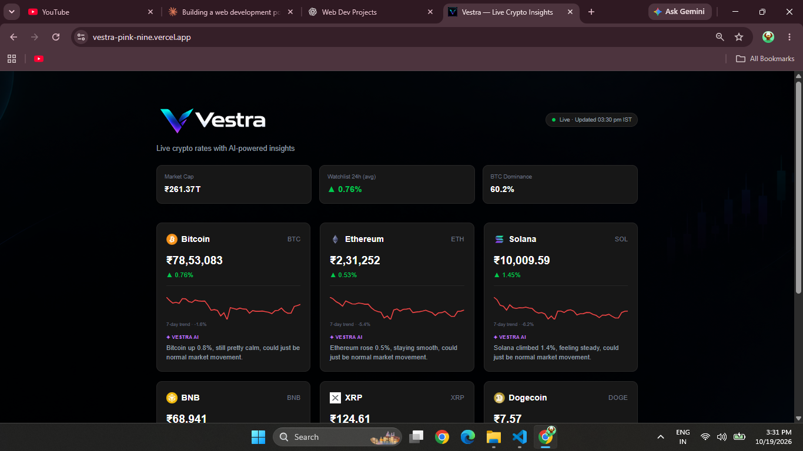

# Vestra

**Live crypto rates with plain-English AI commentary.**

Vestra is a dashboard that tracks six major cryptocurrencies in Indian rupees, draws a 7-day trend line for each, and adds a short AI-written note that describes what the price has been doing. It is built to keep working when the APIs behind it fail.

**Live demo:** https://vestra-pink-nine.vercel.app/



---

## Features

- **Live prices in INR** for Bitcoin, Ethereum, Solana, BNB, XRP and Dogecoin, with 24-hour change.
- **7-day sparkline** on every card, drawn as a lightweight SVG, with the weekly percentage change next to it.
- **Market overview** showing total crypto market cap, Bitcoin dominance, and the average 24-hour change of the watchlist.
- **Vestra AI commentary**: one short, friendly sentence per coin that describes the price move in plain language.
- **Honest AI design**: the model only sees each coin's percentage change, is told not to invent causes such as news or partnerships, and must keep any hedged guess consistent with the direction of the move.
- **Loading skeleton** shown while data is fetched.
- **Graceful error states**: missing data shows "—" or "Price unavailable" with a banner instead of a broken page.
- **Responsive layout** from phone to desktop, with a timestamp shown in IST.
- **Disclaimer** that the commentary is informational and not financial advice.

## Tech stack

| Area | Technology |
| --- | --- |
| Framework | Next.js (App Router, server components) |
| Language | TypeScript |
| Styling | Tailwind CSS |
| Hosting | Vercel |
| Charts | Hand-built SVG, no chart library |

## APIs used

| API | Used for |
| --- | --- |
| CoinGecko `simple/price` | Current INR prices and 24-hour change |
| CoinGecko `coins/{id}/market_chart` | 7-day price history for the sparklines |
| CoinGecko `global` | Total market cap and Bitcoin dominance |
| Google Gemini (`gemini-flash-latest`) | Primary AI commentary |
| Groq (`openai/gpt-oss-20b`) | Fallback AI commentary |

## How it works

The page is a server component. All API calls run on the server, so the Gemini, Groq and CoinGecko keys are never sent to the browser.

1. Prices and 24-hour changes are fetched in one CoinGecko call.
2. Sparkline history, market overview and AI commentary are fetched next.
3. The AI gets one prompt for all six coins and returns a JSON array of six sentences.
4. The page is rendered on the server and revalidated every 60 seconds. Prices are cached for 60 seconds, and sparklines and AI responses for 15 minutes.

## Reliability and fallback handling

Free APIs fail often, so every external call is treated as unreliable.

- **AI fallback chain:** Gemini is tried twice with a 4-second timeout each. If both fail, Groq is tried once with a 6-second timeout. If that fails too, the cards show "Commentary unavailable." and the rest of the page still works.
- **Response validation:** AI output must be a JSON array with exactly one non-empty string per coin. Anything else is rejected and counts as a failure.
- **Timeouts everywhere:** every request is aborted if it takes too long, so one slow service cannot hang the page.
- **Retries with backoff:** sparkline and market-overview requests retry on failure. Sparklines are fetched one at a time with a short pause, because firing them all at once triggered CoinGecko's rate limit.
- **Partial failure:** a failed chart hides only that chart. A failed market overview shows "—" in its boxes. If prices fail entirely, a banner appears and the status pill turns yellow.
- **Self-healing cache:** only successful responses are cached, so a failed chart is simply retried on the next refresh.

## Run it locally

```bash
git clone https://github.com/kukusgit/vestra.git
cd vestra
npm install
```

Create a `.env.local` file in the project root:

```
GEMINI_API_KEY=your_gemini_key
GROQ_API_KEY=your_groq_key
COINGECKO_API_KEY=your_coingecko_demo_key
```

`COINGECKO_API_KEY` is optional. Without it the app works, but CoinGecko may rate-limit requests more often. Then start the dev server:

```bash
npm run dev
```

Open http://localhost:3000.

When deploying to Vercel, add the same variables under Settings → Environment Variables and redeploy.

## Limitations

- The watchlist is fixed at six coins by design.
- The free API tiers have rate limits, so data can occasionally be a minute or two behind.
- The AI commentary describes price movement only. It does not know why a coin moved and says so.

## Possible next steps

- Search and a larger coin list
- Per-coin detail pages with interactive charts

---

Built by Umang, with AI-assisted development.
